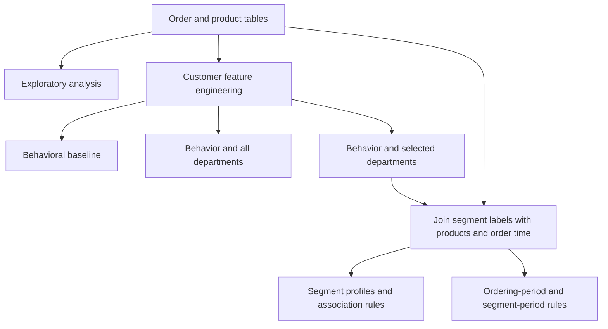

# Customer Segmentation and Time-Based Market Basket Analysis

**An independent undergraduate machine learning project analyzing 32.4 million historical order–product records from 206,209 grocery shoppers.**

This project investigates how purchasing frequency, repeat purchasing, and product preferences can be combined to understand customer behavior. It connects **K-means clustering** with **Apriori association rule mining**, then examines product associations within customer segments and ordering periods.

The analysis produces interpretable customer profiles and candidate product associations that could inform recommendation or merchandising decisions. Evaluating their effectiveness on future purchases remains a next step.

**Tools:** Python · pandas · NumPy · scikit-learn · mlxtend · Matplotlib · seaborn · Jupyter

## Motivation and Research Questions

Popular products dominate aggregate shopping statistics, making more specific preferences difficult to see. This project explores how changing the representation of a customer changes the patterns that emerge.

The analysis addresses four questions:

1. What customer groups emerge from ordering frequency, purchase intervals, and repeat purchasing?
2. How do those groups change when product-category preferences are included?
3. What patterns become visible when the two most commonly purchased departments—produce and dairy/eggs—are excluded from the feature set?
4. What products are associated within each segment, and how do the associations vary by ordering period?

## My Contribution

I independently developed this project as a machine learning course final project. My work covered:

- Integrating relational order, product, and department data.
- Designing customer-level behavioral and preference features.
- Implementing and comparing three K-means feature configurations.
- Building order-level transaction matrices for Apriori association mining.
- Extending the analysis to ordering periods and selected segment–period combinations.
- Creating visualizations, interpreting customer profiles, and identifying methodological limitations.

## Selected Findings

The nine-cluster segmentation using behavioral features and department preferences, with produce and dairy/eggs excluded from the feature set, reveals five specialized shopping profiles:

| Shopping profile (cluster) | Customers | Supporting evidence |
| --- | ---: | --- |
| Beverage & snack shoppers (0) | 16,753 | Beverages and snacks account for mean purchase shares of 32.6% and 25.2%, respectively. |
| Frozen-food shoppers (2) | 16,842 | Frozen products account for a mean purchase share of 25.0%. |
| Household-oriented shoppers (3) | 7,647 | Household and personal care products account for mean purchase shares of 22.5% and 12.9%, respectively. |
| Alcohol-oriented shoppers (6) | 1,995 | Alcohol accounts for a mean purchase share of 47.3%. |
| Baby-product shoppers (8) | 4,521 | Baby products account for a mean purchase share of 20.9%. |

Frequently purchased products provide concrete examples of these preferences:

| Cluster | Representative products |
| --- | --- |
| 0 — Beverage & snack | Soda; Sparkling Water Grapefruit; Spring Water; Lime Sparkling Water. |
| 2 — Frozen food | Blueberries; Macaroni & Cheese; Organic Broccoli Florets; Chocolate Ice Cream. |
| 3 — Household | Ultra Soft Facial Tissues; White Giant Paper Towel Rolls; Select-A-Size White Paper Towels. |
| 6 — Alcohol | India Pale Ale; Beer; Sauvignon Blanc; Cabernet Sauvignon; Chardonnay. |
| 8 — Baby products | Baby Food Stage 2 Blueberry Pear & Purple Carrot; Spinach Peas & Pear Stage 2 Baby Food. |

Product examples are drawn from the most frequently purchased items in each cluster after excluding produce and dairy/eggs. These lists summarize product popularity within a segment; joint purchases are examined separately through association rules.

The analysis also identifies a behavioral pattern in **cluster 7**: its 36,794 customers average 43.6 recorded orders, a 7.9-day order interval, and a 68.7% repeat-purchase ratio. This group highlights frequent repeat purchasing alongside the category-oriented profiles above.

Customer counts and category shares were calculated from the saved segmentation table, and product examples were checked against the historical analysis table. Category shares are averaged across customers and retain all purchased products in the denominator. These are five selected profiles from a nine-cluster result; profile names are interpretations of shopping behavior, and demographic characteristics are not available.


*Mean department purchase ratios by cluster, excluding produce and dairy/eggs from the displayed features. The figure is extracted from the saved output of the cluster analysis notebook.*

The association analysis also identifies combinations of related products. For example, the saved morning-period rules include:

| Antecedent | Consequent | Support | Confidence | Lift |
| --- | --- | ---: | ---: | ---: |
| Peach Pear Flavored Sparkling Water | Sparkling Water Berry | 0.344% | 20.8% | 14.59 |

This rule describes co-occurrence within morning orders retained after category and popular-product filtering. Its high lift indicates a strong association relative to that filtered population's baseline; it does not establish recommendation accuracy or a causal relationship.

## Dataset

The project uses the **Instacart Market Basket Analysis** dataset. See the [Kaggle competition data page](https://www.kaggle.com/c/basket-analysis/data) or the [community-hosted six-file dataset](https://www.kaggle.com/datasets/psparks/instacart-market-basket-analysis).

| Entity | Records |
| --- | ---: |
| Customers | 206,209 |
| Orders | 3,421,083 |
| Historical order–product records (`prior`) | 32,434,489 |
| Training order–product records (`train`) | 1,384,617 |
| Products | 49,688 |
| Departments | 21 |
| Aisles | 134 |

An order–product record represents one product in one order. Segmentation and association mining primarily use the historical `prior` records. The `train` records are currently loaded for inspection in the exploratory notebook rather than used for predictive evaluation.

## Methodology

### 1. Exploratory Data Analysis

Inspect table schemas and sizes, join products with category information, and examine popular products, departments, aisles, and ordering hours. This establishes the data structure and motivates the feature experiments.

### 2. Customer Feature Engineering

Aggregate transaction history into one row per customer:

| Feature | Definition |
| --- | --- |
| `total_orders` | Maximum recorded order number for each customer. |
| `avg_days_between_orders` | Mean recorded interval between orders. |
| `reorder_ratio` | Mean `reordered` indicator across historical order–product records. |
| Department purchase shares | Each department's record count divided by the customer's total historical product-record count. |

The first two behavioral features use the orders table; the repeat-purchase ratio and category shares use historical product records.

### 3. Customer Segmentation

Three configurations explore the effect of feature selection:

| Configuration | Features | Current K |
| --- | --- | ---: |
| Behavioral baseline | Three behavioral features | 5 |
| Behavior + all departments | Three behavioral features + 21 department shares | 9 |
| Behavior + selected departments | Three behavioral features + 19 department shares, excluding produce and dairy/eggs | 9 |

Features are standardized with `StandardScaler` before K-means. The selected-department configuration supplies the labels used in subsequent segment and time-period analyses.

Excluding two departments removes their feature columns without renormalizing the remaining shares. Elbow plots inspect within-cluster error across K values. PCA projects the standardized features into two dimensions for visualization; the current clustering operates on the original standardized features.

### 4. Segment-Level Association Mining

Join customer labels back to historical product records and construct binary order–product matrices. Within each segment:

- Exclude produce and dairy/eggs.
- Retain its 100 most frequent products.
- Apply Apriori with minimum support of 0.3%, 0.5%, or 1%, depending on the segment.
- Generate rules with lift at least 1 and sort them by lift.

### 5. Ordering-Period Analysis

Repeat association mining across four ordering periods, using minimum support of 0.3%:

| Period | Ordering hours |
| --- | --- |
| Morning | 05–11 |
| Afternoon | 12–17 |
| Evening | 18–21 |
| Midnight | 22–23 and 00–04 |

The notebook additionally examines all four periods within clusters 0, 6, and 8.



## Critical Evaluation and Next Steps

The project demonstrates a workflow for extracting interpretable shopping patterns from a large relational dataset. The findings also expose questions that require further validation:

- **Choosing K:** The elbow curve has no clear turning point. Nine clusters are an exploratory choice, not a demonstrated optimum. Silhouette analysis and stability checks across seeds and resampled customers are appropriate next experiments.
- **Representation and initialization:** Behavioral and category features may have unequal aggregate influence, and sparse category shares can contain extreme values. The elbow sweep explicitly uses `n_init=10`, while the final selected-department model uses the default; these settings should be aligned before making comparisons.
- **Counting orders:** Some time-distribution plots count product records while labeling the axis as orders. Unique `order_id` counts and within-segment proportions are needed to evaluate ordering frequency.
- **Comparing associations:** Product filtering changes the transaction population used for support. Different product sets and thresholds also prevent direct comparisons based only on the number of rules.
- **Predictive evaluation:** A next-order holdout would test whether segment-specific rules outperform global associations or popular-product recommendations. Features and models would need to be fitted using only the training history.

These considerations distinguish observable patterns from claims about an optimal segmentation or an effective recommendation system.

## Repository Guide

The main implementation is in Jupyter notebooks. Start with the [customer segmentation experiment](Final%20Project/notebooks/03_customer_segmentation_without_produce_dairy.ipynb), [segment analysis](Final%20Project/notebooks/06_cluster_analysis.ipynb), and [ordering-period analysis](Final%20Project/notebooks/07_time_aware_analysis.ipynb) to review existing results.

```text
.
├── README.md
├── .gitignore
├── GroupI.pdf                         # Supporting project document
└── Final Project/
    ├── notebooks/                     # Analysis implementation and saved outputs
    ├── data/
    │   ├── raw/                       # Downloaded input files; excluded from Git
    │   └── processed/
    │       ├── *.csv                  # Generated intermediate tables; excluded from Git
    │       ├── association_rules/      # Segment-level rules
    │       ├── time_rules/             # Ordering-period rules
    │       └── cluster_time_rules/     # Segment-period rules
    ├── results/figures/                # Exported visualizations
    ├── report/                        # Reserved report directory
    ├── src/                           # Empty module placeholders
    └── requirements.txt               # Currently empty; install instructions below
```

| Notebook | Purpose |
| --- | --- |
| [01_eda.ipynb](Final%20Project/notebooks/01_eda.ipynb) | Explore raw tables, product popularity, categories, and ordering hours. |
| [02_feature_engineering.ipynb](Final%20Project/notebooks/02_feature_engineering.ipynb) | Export customer behavioral features to `user_features.csv`. |
| [03_customer_segmentation_loyal_cluster.ipynb](Final%20Project/notebooks/03_customer_segmentation_loyal_cluster.ipynb) | Fit the five-cluster behavioral baseline and export `user_clusters.csv`. |
| [03_customer_segmentation_loyal_dept_cluster.ipynb](Final%20Project/notebooks/03_customer_segmentation_loyal_dept_cluster.ipynb) | Explore segmentation using behavior and all department shares. |
| [03_customer_segmentation_without_produce_dairy.ipynb](Final%20Project/notebooks/03_customer_segmentation_without_produce_dairy.ipynb) | Export the selected-department nine-cluster segmentation. |
| [04_cluster_preference_analysis_loyal.ipynb](Final%20Project/notebooks/04_cluster_preference_analysis_loyal.ipynb) | Inspect product preferences within the behavioral baseline. |
| [04_prepare_analysis_table.ipynb](Final%20Project/notebooks/04_prepare_analysis_table.ipynb) | Export `cluster_analysis_table.csv` with customer, cluster, product, and time information. |
| [06_cluster_analysis.ipynb](Final%20Project/notebooks/06_cluster_analysis.ipynb) | Interpret segments and mine segment-level associations. |
| [07_time_aware_analysis.ipynb](Final%20Project/notebooks/07_time_aware_analysis.ipynb) | Mine ordering-period and segment-period associations. |

The empty `04_market_basket_analysis.ipynb`, `05_time_aware_analysis.ipynb`, and extensionless `03_customer_segmentation_loyal_dept_noProduceDairyEgg_cluster` are draft placeholders. Filenames containing `loyal` refer to behavioral segmentation experiments; the code does not prefilter customers by loyalty.

## Running the Analysis

### Data Preparation

Download and extract the six input files into `Final Project/data/raw/`:

```text
aisles.csv
departments.csv
orders.csv
order_products__prior.csv
order_products__train.csv
products.csv
```

### Environment Setup

The local development environment uses **Python 3.12.3** with NumPy 2.4.4, pandas 3.0.3, scikit-learn 1.8.0, Matplotlib 3.10.9, seaborn 0.13.2, mlxtend 0.24.0, and JupyterLab 4.5.7.

Since `requirements.txt` is currently empty, install the main dependencies explicitly. The following commands use Windows PowerShell from the repository root:

```powershell
cd "Final Project"
python -m venv .venv
.\.venv\Scripts\python.exe -m pip install --upgrade pip
.\.venv\Scripts\python.exe -m pip install numpy==2.4.4 pandas==3.0.3 scikit-learn==1.8.0 matplotlib==3.10.9 seaborn==0.13.2 mlxtend==0.24.0 jupyterlab==4.5.7
.\.venv\Scripts\python.exe -m ipykernel install --user --name final_project --display-name "final_project"
New-Item -ItemType Directory -Force -Path data/raw, data/processed | Out-Null
.\.venv\Scripts\python.exe -m jupyterlab notebooks
```

Select the `final_project` kernel. Each notebook expects `Final Project/notebooks/` as its working directory because data paths are relative.

### Execution Order

Run each notebook from a fresh kernel, executing its cells in order:

1. `01_eda.ipynb`
2. `02_feature_engineering.ipynb`
3. `03_customer_segmentation_without_produce_dairy.ipynb`
4. `04_prepare_analysis_table.ipynb`
5. `06_cluster_analysis.ipynb`
6. `07_time_aware_analysis.ipynb`

For the behavioral baseline, run `03_customer_segmentation_loyal_cluster.ipynb` after feature engineering, followed by `04_cluster_preference_analysis_loyal.ipynb`.

The full workflow joins approximately 32.4 million product records. The generated analysis table is about 1.9 GB, and in-memory joins require substantially more memory than the CSV size. A consistent customer subset can be used for an initial run, with sampled findings reported separately from full-data results.

### Reproducibility Notes

Dependency versions above reflect the current local environment; a complete execution in a fresh environment has not been verified. Some saved notebook outputs come from earlier configurations. The all-department experiment contains an older ten-cluster basket summary despite its current nine-cluster setting; the behavioral preference plots currently cover only clusters 0–3 of the five-cluster baseline. The segment-rule export also retains a `PermissionError` from an earlier execution. Re-run from a clean kernel and confirm output files are writable before treating generated tables as a consistent run.

## Data and Output Management

Raw files, local dataset archives, virtual environments, and generated intermediate tables are excluded through `.gitignore`. Download the inputs and rebuild intermediate tables using the notebook sequence. Exported figures and small association-rule CSVs remain suitable for inclusion.

The local dataset archive, historical product-record CSV, and analysis table exceed GitHub's 100 MiB limit for ordinary Git files. See [GitHub's large-file documentation](https://docs.github.com/en/repositories/working-with-files/managing-large-files/about-large-files-on-github).
